# 🛡️ Agentic Sherlock AI — End-to-End Architecture Flow
**Hierarchical Multi-Agent Cognitive Forensic Reconstruction Framework (H-MACFR)**  
*B.Tech Capstone Project | Team G1266 | Mentor: Para Upendar*  
*Team: Kishor (Registry), Bharath (Memory), Aswith (Disk), Pranay (Network), Sanhith (Logs)*

---

## 1. Complete End-to-End Flowchart

```mermaid
flowchart TD

    %% =====================================================
    %% STYLING DEFINITIONS
    %% =====================================================
    classDef authStyle fill:#f1f5f9,stroke:#64748b,stroke-width:2px,color:#0f172a;
    classDef vaultStyle fill:#eff6ff,stroke:#2563eb,stroke-width:2px,color:#1e3a8a;
    classDef agentStyle fill:#f5f3ff,stroke:#7c3aed,stroke-width:2px,color:#4c1d95;
    classDef loopStyle fill:#fef3c7,stroke:#d97706,stroke-width:2px,color:#78350f;
    classDef knowStyle fill:#ecfeff,stroke:#0891b2,stroke-width:2px,color:#164e63;
    classDef sisStyle fill:#fdf4ff,stroke:#c026d3,stroke-width:2px,color:#701a75;
    classDef outStyle fill:#ecfdf5,stroke:#059669,stroke-width:2px,color:#064e3b;
    classDef gpuStyle fill:#0f172a,stroke:#38bdf8,stroke-width:2px,color:#f8fafc;

    %% =====================================================
    %% ZONE 0: ACCESS CONTROL & CASE INITIALIZATION
    %% =====================================================
    subgraph Zone0 ["Zone 0: Access Control & Case Initialization"]
        AUTH["Investigator Authentication<br/>(Admin, Lead Auditor, Investigator)"]
        RBAC["RBAC Clearance &amp; JWT Issuance<br/>(Level 1 to 5 Separation)"]
        CASE_INIT["Case Creation &amp; Scope Registration<br/>(UUID, Priority, Target Host, Scope)"]
        
        AUTH --> RBAC --> CASE_INIT
    end

    %% =====================================================
    %% ZONE 1: EVIDENCE INGESTION & CRYPTOGRAPHIC PRESERVATION
    %% =====================================================
    subgraph Zone1 ["Zone 1: Evidence Ingestion &amp; Cryptographic Vault (ISO/IEC 27037)"]
        RAW_EVID["Multi-Source Digital Evidence Ingestion<br/>• PCAP Network Streams<br/>• Volatile Memory RAM Dumps<br/>• Disk Images (E01/RAW/DD)<br/>• Windows Security / Sysmon EVTX Logs<br/>• SAM / SYSTEM / SOFTWARE Registry Hives"]
        
        HASH_SEAL["Cryptographic Sealing Engine<br/>• Streaming SHA-256 Multi-Pass Digest<br/>• MD5 &amp; SHA-1 Heritage Checksums<br/>• HMAC-SHA256 Digital Signature Tag"]
        
        VAULT["Write-Blocked Evidence Vault<br/>• Read-Only OS Permission Enclave<br/>• AES-256-GCM Vault Encryption<br/>• Tamper-Evident Append-Only Audit Ledger"]
        
        RAW_EVID --> HASH_SEAL --> VAULT
    end

    CASE_INIT --> RAW_EVID

    %% =====================================================
    %% ZONE 2: SUPERVISOR DISPATCH & 5 DOMAIN AGENT EXTRACTION
    %% =====================================================
    subgraph Zone2 ["Zone 2: Multi-Agent Extraction &amp; Cognitive Evaluation (42 Contracts)"]
        SUP_DISPATCH["Master Supervisor Agent<br/>(Base Cybersecurity QLoRA Orchestrator)"]

        AG_NET["Network Agent (Pranay)<br/>LoRA: network_adapter<br/>9 Contracts: PCAP flows, DNS,<br/>TCP/UDP, Browser, Email"]
        
        AG_MEM["Memory Agent (Bharath)<br/>LoRA: memory_adapter<br/>10 Contracts: Volatility 3,<br/>pslist, injected DLLs, malfind, handles"]
        
        AG_DISK["Disk Agent (Aswith)<br/>LoRA: disk_adapter<br/>11 Contracts: MFT, LNK shortcuts,<br/>Prefetch, JumpLists, RecycleBin"]
        
        AG_LOG["Log Agent (Sanhith)<br/>LoRA: log_adapter<br/>6 Contracts: EVTX, Sysmon EID 1/3/7,<br/>PowerShell 4104, Logon audit"]
        
        AG_REG["Registry Agent (Kishor)<br/>LoRA: registry_adapter<br/>6 Contracts: Software inventory,<br/>USB history, Run/RunOnce persistence"]

        VAULT --> SUP_DISPATCH
        SUP_DISPATCH --> AG_NET
        SUP_DISPATCH --> AG_MEM
        SUP_DISPATCH --> AG_DISK
        SUP_DISPATCH --> AG_LOG
        SUP_DISPATCH --> AG_REG
    end

    %% =====================================================
    %% HARDWARE INFERENCE INFRASTRUCTURE
    %% =====================================================
    subgraph GPU_INFRA ["Hardware Inference Execution Engine"]
        COLAB_BRIDGE["Google Colab Cloud GPU Bridge<br/>(NVIDIA T4 / A100 • 15GB VRAM)<br/>Fast Cloudflare / ngrok HTTPS Tunnel<br/>Qwen2.5-7B-Instruct 4-bit QLoRA"]
        
        LOCAL_FALLBACK["Local Air-Gapped Cognitive Engine<br/>(100% Offline CPU Enclave)<br/>NIST SP 800-86 &amp; MITRE ATT&amp;CK Rules<br/>Deterministic Fallback Evaluator"]
        
        AG_NET & AG_MEM & AG_DISK & AG_LOG & AG_REG -.-> COLAB_BRIDGE
        AG_NET & AG_MEM & AG_DISK & AG_LOG & AG_REG -.-> LOCAL_FALLBACK
    end

    %% =====================================================
    %% ZONE 3: CROSS-DOMAIN CORRELATION & SUFFICIENCY LOOP
    %% =====================================================
    subgraph Zone3 ["Zone 3: Cross-Domain Correlation &amp; Sufficiency Verification"]
        NORM_FILTER["Contract Normalizer &amp; Noise Filter<br/>(Strips intermediate carves; retains 42 JSONs)"]
        
        CORR_ENG["Multi-Source Correlation Engine<br/>• IP-to-Process Socket Mapping<br/>• Timestamp Alignment across Logs &amp; MFT<br/>• Persistence-to-Execution Linkage"]
        
        SUFF_CHECK{"Evidence<br/>Sufficient?"}

        AG_NET & AG_MEM & AG_DISK & AG_LOG & AG_REG --> NORM_FILTER
        NORM_FILTER --> CORR_ENG --> SUFF_CHECK
        
        SUFF_CHECK -- "No: Missing Clues / Incomplete Chain" --> RAW_EVID
    end

    %% =====================================================
    %% ZONE 4: KNOWLEDGE REPRESENTATION & RAG RETRIEVAL
    %% =====================================================
    subgraph Zone4 ["Zone 4: Knowledge Representation &amp; Grounded RAG"]
        KG[("Forensic Knowledge Graph<br/>Entities: Hosts, IPs, PIDs, Files<br/>Edges: Created, Connected, Injected")]
        
        VDB[("Vector Database Embeddings<br/>Semantic Indicator Retrieval")]
        
        RAG["Evidence-Grounded RAG Engine<br/>Retrieval Augmented Reasoning"]

        SUFF_CHECK -- "Yes: Sufficient Evidence" --> KG
        SUFF_CHECK -- "Yes: Sufficient Evidence" --> VDB
        KG & VDB --> RAG
    end

    %% =====================================================
    %% ZONE 5: STRUCTURED INVESTIGATION STATE (SIS) & HUMAN REVIEW
    %% =====================================================
    subgraph Zone5 ["Zone 5: Structured Investigation State (SIS) &amp; Review Station"]
        SIS["Structured Investigation State (SIS)<br/>• Unified Incident Chronology<br/>• Validated Adversary Hypotheses<br/>• Confidence Metric Calculation (0-100%)<br/>• MITRE ATT&amp;CK v14 Technique Mapping"]
        
        REV_STATION{"Human Investigator<br/>Review Station"}
        
        RAG --> SIS --> REV_STATION
        
        REV_STATION -- "Reject / Request Re-analysis" --> SUP_DISPATCH
    end

    %% =====================================================
    %% ZONE 6: COURT-ADMISSIBLE ON-DEMAND DELIVERABLES
    %% =====================================================
    subgraph Zone6 ["Zone 6: Court-Admissible Output Deliverables"]
        REV_STATION -- "Approve &amp; Lock State" --> DELIV["Investigation Outputs Hub"]

        OUT_TIMELINE["1. Attack Timeline<br/>Chronological reconstructed milestones<br/>from Initial Access to Exfiltration"]
        
        OUT_ATTRIB["2. Attribution &amp; TTP Matrix<br/>Threat actor techniques mapped to<br/>MITRE ATT&amp;CK enterprise matrix"]
        
        OUT_REPORT["3. Court-Ready Forensic Report<br/>ISO/IEC 27037 Compliant Documentation<br/>Cryptographic chain of custody &amp; hash proofs"]
        
        OUT_CHAT["4. Interactive Investigator Chatbot<br/>RAG evidence interrogation grounded<br/>in the approved SIS state"]

        DELIV --> OUT_TIMELINE
        DELIV --> OUT_ATTRIB
        DELIV --> OUT_REPORT
        DELIV --> OUT_CHAT

        OUT_CHAT -. "Follow-up Hypothesis Query" .-> SIS
    end

    %% Class Assignments
    class AUTH,RBAC,CASE_INIT authStyle;
    class RAW_EVID,HASH_SEAL,VAULT vaultStyle;
    class SUP_DISPATCH,AG_NET,AG_MEM,AG_DISK,AG_LOG,AG_REG agentStyle;
    class NORM_FILTER,CORR_ENG,SUFF_CHECK loopStyle;
    class KG,VDB,RAG knowStyle;
    class SIS,REV_STATION sisStyle;
    class DELIV,OUT_TIMELINE,OUT_ATTRIB,OUT_REPORT,OUT_CHAT outStyle;
    class COLAB_BRIDGE,LOCAL_FALLBACK gpuStyle;
```

---

## 2. Zone-by-Zone Execution Breakdown

### Zone 0: Access Control & Case Lifecycle
* **Authentication**: Multi-tier role-based access control supporting **Administrator**, **Lead Auditor**, **Senior Investigator**, and **Forensic Specialist**.
* **Case Setup**: Generates an authoritative case UUID container, establishes access control lists (ACLs), and creates an immutable chain-of-custody log.

---

### Zone 1: Evidence Ingestion & Cryptographic Preservation Vault
* **Standard**: Strict compliance with **ISO/IEC 27037:2012** (Guidelines for identification, collection, acquisition, and preservation of digital evidence).
* **Multi-Format Ingestion**: Ingests PCAP network captures, volatile memory (RAM), forensic disk images (RAW/DD/E01), Windows Security/Sysmon event logs (`.evtx`), and Registry hives (`SAM`, `SYSTEM`, `SOFTWARE`).
* **Cryptographic Sealing**:
  * Real-time multi-pass **SHA-256**, **SHA-1**, and **MD5** digest generation at upload boundary.
  * **HMAC-SHA256** digital signature calculated using a hardware/environment-backed secret key.
  * Storage inside an **AES-256-GCM** write-blocked enclave with operating-system read-only file permissions.

---

### Zone 2: Multi-Agent Extraction & Cognitive Evaluation Engine
* **Supervisor Agent**: Fine-tuned on the `Cybersecurity_Qwen3_QLoRA` base package. Reads ingested evidence headers, formulates the extraction plan, and dispatches tasks.
* **5 Specialized Domain Agents (42 Standardized Contracts)**:
  1. **Network Agent (Pranay)** — `network_adapter`:
     * Generates: `network_summary.json`, `dns_analysis.json`, `network_connections.json`, `browser_history.json`, `browser_cookies.json`, `browser_downloads.json`, `email_messages.json`, `email_attachments.json`, `email_summary.json`.
  2. **Memory Agent (Bharath)** — `memory_adapter`:
     * Powered by Volatility 3: `memory_summary.json`, `processes.json`, `process_tree.json`, `network_connections.json`, `injected_code.json`, `dll_list.json`, `driver_list.json`, `handles.json`, `malfind.json`, `yara_matches.json`.
  3. **Disk Agent (Aswith)** — `disk_adapter`:
     * Generates: `disk_summary.json`, `file_system.json`, `deleted_files.json`, `mft_analysis.json`, `usnjrnl_analysis.json`, `lnk_files.json`, `prefetch_files.json`, `shellbags.json`, `jumplists.json`, `recycle_bin.json`, `shadow_copies.json`.
  4. **Log Agent (Sanhith)** — `log_adapter`:
     * Generates: `log_summary.json`, `security_events.json`, `system_events.json`, `powershell_events.json`, `sysmon_events.json`, `logon_events.json`.
  5. **Registry Agent (Kishor)** — `registry_adapter`:
     * Generates: `registry_summary.json`, `system_info.json`, `autorun_entries.json`, `user_accounts.json`, `usb_devices.json`, `installed_software.json`.

---

### Hardware Inference Execution Engine
* **Google Colab Cloud GPU Bridge**:
  * Offloads heavy LLM token generation to a free Google Colab instance with an **NVIDIA T4 (15 GB VRAM)** running `Qwen2.5-7B-Instruct` in 4-bit precision.
  * Connects over a high-speed Cloudflare Quick Tunnel / ngrok HTTPS tunnel.
* **Local Air-Gapped Cognitive Engine**:
  * If Colab is disconnected or offline, Sherlock AI automatically activates its local rule-based heuristic evaluator grounded in **NIST SP 800-86** and **MITRE ATT&CK**.
  * Ensures 100% uptime on laptops without dedicated GPUs.

---

### Zone 3: Sufficiency Loop & Cross-Domain Correlation
* **Noise Filtering**: Cleans out raw carving dumps and intermediate buffers; only validated contract JSON files enter the correlation engine.
* **Correlation Engine**:
  * Maps network socket connections to active memory PIDs and disk executables.
  * Aligns timestamps across EVTX logs, MFT record changes, and Prefetch execution counters.
* **Sufficiency Verification Loop**:
  * Checks if evidence is sufficient to answer: *Initial Access*, *Execution*, *Persistence*, and *Exfiltration*.
  * If missing, loops back to request specific follow-up artifacts from the investigator.

---

### Zone 4: Knowledge Representation & Semantic Retrieval
* **Forensic Knowledge Graph (KG)**: Directed property graph mapping hosts, accounts, processes, hashes, domains, and causal parent-child relationships.
* **Vector Database (VDB)**: High-dimensional semantic embeddings for forensic artifact search.
* **RAG Pipeline**: Retrieves grounded evidence context to eliminate LLM hallucinations.

---

### Zone 5: Structured Investigation State (SIS) & Human Review Station
* **Structured Investigation State (SIS)**:
  * Canonical, serializable investigation snapshot containing validated entities, attack milestones, causal hypotheses, confidence scores, and evidence pointers.
* **Human-in-the-Loop Review Station**:
  * Forensic investigator can inspect, refine, or override AI hypotheses.
  * **Approve & Lock**: Seals the state for final courtroom report generation.
  * **Reject / Request More Evidence**: Loops back to the Supervisor Agent for targeted re-analysis.

---

### Zone 6: Court-Admissible Output Deliverables
1. **Attack Timeline**: Interactive chronological reconstruction from initial vector to impact.
2. **Attribution & TTP Matrix**: Threat actor tactics and techniques mapped against MITRE ATT&CK v14.
3. **Court-Ready Forensic Report**: Formatted according to ISO/IEC 27037 standards with verified SHA-256 chain-of-custody logs ready for legal export.
4. **Interactive Case Chatbot**: Natural language Q&A assistant strictly grounded in the approved SIS evidence state.
