# HMACFR — Hierarchical Multi-Agent Forensic Reconstruction Architecture

This document provides a detailed architectural specification for the **HMACFR** (Hierarchical Multi-Agent Forensic Reconstruction & Preservation) platform.

---

## Architecture Flowchart

```mermaid
flowchart LR

    %% =====================================================
    %% EVIDENCE INGESTION & PRESERVATION
    %% =====================================================

    A["Evidence Upload<br/>PCAP • RAM • Disk • Logs<br/>Browser • Email • Registry"] 
        --> B["Evidence Preservation<br/>Upload → Hash → Preserve"]

    B --> C["Artifact Extraction<br/>Extract • Parse • Normalize"]

    %% =====================================================
    %% MULTI-AGENT FORENSIC ANALYSIS
    %% =====================================================

    C --> D["Supervisor / Multi-Agent Analysis"]

    D --> N["Network Agent<br/>PCAP • DNS • Connections"]
    D --> M["Memory Agent<br/>RAM • Processes • Modules"]
    D --> L["Log Agent<br/>Event Logs • System Logs • Registry"]

    N --> E["Correlation Engine"]
    M --> E
    L --> E

    %% =====================================================
    %% EVIDENCE SUFFICIENCY CHECK
    %% =====================================================

    E --> F{"Sufficient<br/>Evidence?"}

    F -- "No / Missing Evidence" --> A

    %% =====================================================
    %% KNOWLEDGE & RETRIEVAL LAYER
    %% =====================================================

    F -- "Yes" --> G["Knowledge Representation"]

    G --> KG[("Knowledge Graph<br/>Entities • Events • Relationships")]
    G --> VDB[("Vector Database<br/>Semantic Evidence Retrieval")]

    KG --> R["RAG Pipeline"]
    VDB --> R

    R --> LLM["LLM Reasoning Layer<br/>Evidence-Grounded Reasoning"]

    %% =====================================================
    %% STRUCTURED INVESTIGATION STATE
    %% =====================================================

    LLM --> SIS["SIS<br/>Structured Investigation State<br/><br/>Entities • Events • Relationships<br/>Hypotheses • Confidence"]

    %% =====================================================
    %% INVESTIGATOR REVIEW
    %% =====================================================

    SIS --> IR{"Investigator Review<br/>Modify SIS?"}

    INVEST["Investigator"] --> IR

    IR -- "Yes / Modify" --> SIS
    IR -- "No / Accept" --> O

    %% =====================================================
    %% INVESTIGATION OUTPUTS
    %% =====================================================

    O["Investigation Outputs"]

    O --> T["Attack Timeline<br/>Chronological Event Reconstruction"]
    O --> AT["Attribution<br/>Possible Source / Actor"]
    O --> REP["Court-Ready Forensic Report<br/>Structured Investigation Report"]
    O --> CHAT["Investigator Chat<br/>Interactive Case Investigation"]

    %% =====================================================
    %% OPTIONAL CHAT FEEDBACK
    %% =====================================================

    CHAT -. "Further Investigation Query" .-> SIS


    %% =====================================================
    %% STYLING
    %% =====================================================

    classDef evidence fill:#f4e4d4,stroke:#6b4328,stroke-width:2px,color:#3b2618;
    classDef analysis fill:#e8edf0,stroke:#3b5266,stroke-width:2px,color:#17232d;
    classDef knowledge fill:#eee4f5,stroke:#624878,stroke-width:2px,color:#30213b;
    classDef investigation fill:#f5e6c8,stroke:#8a5a20,stroke-width:2px,color:#3b2618;
    classDef output fill:#e3eee4,stroke:#456b4a,stroke-width:2px,color:#263d29;
    classDef decision fill:#f8efd8,stroke:#8a642c,stroke-width:2px,color:#3b2618;
    classDef store fill:#e7e9ee,stroke:#505a6b,stroke-width:2px,color:#202631;

    class A,B,C evidence;
    class D,N,M,L,E analysis;
    class G,R,LLM knowledge;
    class SIS,IR,INVEST investigation;
    class O,T,AT,REP,CHAT output;
    class F decision;
    class KG,VDB store;
```

---

## Layer Specifications

### 1. Evidence Ingestion & Cryptographic Preservation Layer
* **Evidence Upload (`A`)**: Ingests multi-format digital evidence (PCAP network streams, Volatile Memory RAM dumps, Disk Images, System/Event Logs, Browser Artifacts, Email Headers, and Windows Registry Hives).
* **Evidence Preservation (`B`)**: Calculates multi-pass SHA-256 and MD5 cryptographic digests, computes HMAC-SHA256 digital signatures, applies AES-256-GCM encryption at rest, and locks operating system read-only permissions.
* **Artifact Extraction (`C`)**: Parses, normalizes, and extracts structured forensic indicators (IP addresses, processes, DLLs, file hashes, registry keys, and event timestamps).

---

### 2. Multi-Agent Forensic Analysis Engine
* **Supervisor Agent (`D`)**: Coordinates specialized sub-agents based on evidence categories and distributes workload.
* **Specialized Sub-Agents**:
  * **Network Agent (`N`)**: Analyzes PCAP captures, DNS queries, HTTP headers, TCP/UDP sockets, and network connections.
  * **Memory Agent (`M`)**: Inspects volatile RAM dumps, uncovers hidden processes, injected DLL modules, VAD trees, and memory hooks.
  * **Log Agent (`L`)**: Audits Windows Event Logs, Sysmon telemetry, system service logs, and registry modification trails.
* **Correlation Engine (`E`)**: Cross-correlates multi-source forensic indicators across network, memory, and disk timelines.

---

### 3. Evidence Sufficiency Verification Loop
* **Sufficiency Check (`F`)**: Evaluates whether the collected evidence artifacts are sufficient to construct a complete, court-admissible attack narrative.
  * **Insufficient / Missing Evidence**: Loops back to **Evidence Upload (`A`)**, prompting the investigator to ingest additional memory dumps or log artifacts.
  * **Sufficient Evidence**: Advances to the Knowledge & Retrieval Layer.

---

### 4. Knowledge & Retrieval Layer
* **Knowledge Representation (`G`)**: Constructs dual persistent knowledge representations:
  * **Knowledge Graph (`KG`)**: Captures forensic entities (hosts, IPs, accounts, processes, files), events, and directional relationships.
  * **Vector Database (`VDB`)**: Stores high-dimensional semantic embeddings for context-aware evidence retrieval.
* **RAG Pipeline (`R`)**: Executes Retrieval-Augmented Generation over Knowledge Graph entities and Vector Database embeddings.
* **LLM Reasoning Layer (`LLM`)**: Performs evidence-grounded threat modeling, anomaly identification, and root-cause reasoning.

---

### 5. Structured Investigation State (SIS) & Human-in-the-Loop Review
* **Structured Investigation State (`SIS`)**: Maintains an explicit, evolving investigation state capturing:
  * Identified Entities & Temporal Event Sequences
  * Causal Relationships & Attack Vector Hypotheses
  * Confidence Scores & Evidence Lineage
* **Investigator Review (`IR`)**: Enables human-in-the-loop expert review:
  * **Modify SIS**: Investigator updates, refines, or overrides hypotheses in the SIS state.
  * **Accept**: Investigator approves the SIS state for report and output generation.

---

### 6. Investigation Outputs Layer
* **Attack Timeline (`T`)**: Chronological multi-source event reconstruction from initial access to execution and exfiltration.
* **Attribution (`AT`)**: Evaluates threat actor TTPs against MITRE ATT&CK frameworks for potential source attribution.
* **Court-Ready Forensic Report (`REP`)**: Generates structured, court-admissible forensic documentation with verified SHA-256 chain-of-custody logs.
* **Investigator Chat (`CHAT`)**: Interactive Q&A interface allowing investigators to query the case state, with an iterative feedback loop back to the **SIS**.
