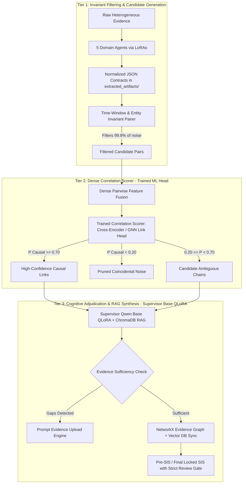

# SherlockAI — Correlation Engine Architecture & Training Strategy

**Document ID:** `SHERLOCKAI-CORRELATION-ENGINE-ARCH-PLAN`  
**Date:** 2026-10-23  
**Status:** ARCHITECTURAL SPECIFICATION & TRAINING ROADMAP  
**Author:** SherlockAI System Architecture Team  

---

## 1. Executive Summary & Problem Formulation

SherlockAI possesses a powerful foundational multi-agent stack:
- **Base Model:** `Cybersecurity Qwen3-8B / Qwen2.5-7B` (Base QLoRA from `Cybersecurity_Qwen3_QLoRA_Package.zip`).
- **5 Specialized Domain Agents (LoRA Adapters from `models.zip`):**
  1. **Network Agent (Pranay):** PCAP flows, DNS queries, network sockets, browser downloads, email streams.
  2. **Memory Agent (Bharath):** RAM processes, DLL modules, handles, unbacked RWX VADs (`windows.malfind`).
  3. **Disk Agent (Aswith):** Master File Table ($MFT), Prefetch execution, LNK shortcuts, Recycle Bin, Jump Lists.
  4. **Log Agent (Sanhith):** Windows Event Logs (`System.evtx`, `Security.evtx`), Sysmon, service installations (Event ID 7045), logons (Event ID 4624).
  5. **Registry Agent (Kishor):** System autoruns (Run/RunOnce keys), USB device history (USBSTOR), installed software.

### The Problem: How Does the Correlation Engine Actually Connect Them?
In a realistic investigation, the 5 agents extract thousands of artifacts. Evaluating every possible pair pairwise using an 8B LLM generates $O(N^2)$ complexity (millions of forward passes), which is computationally infeasible and introduces statistical hallucination risk. Conversely, pure rigid heuristics miss subtle attack patterns.

To solve this, we propose the **Cascaded Neuro-Symbolic Correlation Architecture (CNS-CA)**.

---

## 2. Recommended Approach: Cascaded Neuro-Symbolic Correlation Engine (3-Tier)

---

## 3. Tier-by-Tier Breakdown

### Tier 1: Forensic Invariant Filtering & Candidate Generation (Zero-Latency)
- **Principle:** Hard forensic constraints filter out physical impossibilities before running any machine learning.
- **Rules Enforced:**
  1. *Temporal Monotonicity:* A cause cannot follow its effect ($\Delta t \ge 0$). Inverted pairs are either tagged as `ANOMALOUS_INVERTED_TIMESTAMPS` (e.g. PID reuse) or discarded.
  2. *Temporal Windowing:* Artifacts separated by more than a configurable operational window (e.g. $\pm 30\text{ minutes}$ for interactive attack steps, or same system boot epoch) are excluded from real-time pairing.
  3. *Entity Intersection:* Pairs must share at least one physical invariant: PID, PPID, process image name, file path, user SID, IP address, or port.
- **Outcome:** Reduces 500,000 potential combinations down to 500–1,000 legitimate candidate pairs.

### Tier 2: Trained Cross-Domain Correlation Scorer (Millisecond Inference)
- **Architecture:** A lightweight **Dense Cross-Encoder / Bi-Encoder Link Prediction Head** trained specifically on forensic correlation dataset pairs.
- **Input Vector $X_{ij}$ for pair $(A_i, B_j)$:**
  - $E(A_i), E(B_j)$: Semantic embeddings extracted from the domain adapters.
  - $\Delta t$: Normalized temporal delta in seconds.
  - $\mathbf{v}_{\text{domain}}$: One-hot encoded domain transition vector (e.g., `registry -> disk`, `memory -> memory`, `logs -> disk`).
  - $N_{\text{shared}}$: Integer count of verified shared entity identifiers.
  - $Q_{\text{ts}}$: Timestamp provenance quality score (`EXACT_ORIGIN` vs `APPROXIMATE`).
- **Target Output:**
  $$\hat{y} = P(\text{Causal Link} \mid X_{ij}) \in [0.0, 1.0]$$
- **Speed:** Can score 5,000 candidate pairs in $< 100\text{ ms}$ on local CPU without GPU dependency.

### Tier 3: Supervisor Cognitive Adjudication & RAG Narrative Synthesis
- **Model:** Base Cybersecurity Qwen3-8B QLoRA model.
- **Task:** Takes only the high-confidence causal chains and ambiguous borderline chains ($\hat{y} \in [0.20, 0.70]$) and executes deep cognitive analysis:
  1. Queries ChromaDB for matching MITRE ATT&CK techniques (TTP semantics).
  2. Synthesizes human-readable forensic justifications.
  3. Maps threat actor procedures and confidence bounds.

---

## 4. End-to-End Training & Testing Lifecycle

| Phase | Milestone | Execution Detail |
| :--- | :--- | :--- |
| **Phase 1: Dataset Assembly** | Correlation Dataset Aggregation | Compile candidate pairs using the verified schema (`pilot_phase1c2_audited_expanded_dataset.json` scaled to target investigations). Group splits strictly by `investigation_id` to prevent cross-case data leakage. |
| **Phase 2: Head Training** | Cross-Encoder Training | Train the Tier 2 link prediction head using focal binary cross-entropy loss with class weights, strictly excluding `AMBIGUOUS_UNRESOLVED` from the loss function so the model preserves uncertainty. |
| **Phase 3: Benchmark & Evaluation** | Real Pipeline Harness | Execute `app.cli.evaluate_correlation_pipeline` to measure Precision, Recall, and F1 score against audited ground-truth labels. |
| **Phase 4: Production Integration** | Wire into Synthesizer | Integrate Tier 1 + Tier 2 + Tier 3 into `ForensicSynthesizerService.synthesize_case()`, automatically updating the Knowledge Graph (`EvidenceGraphService`) and Vector DB (`KnowledgeService`). |

---

## 5. Review Gate & Evidence Sufficiency Lifecycle

Once the correlation engine executes:
1. **Evidence Sufficiency Check:**
   - The engine checks if candidate hypotheses have uncorroborated gaps (e.g., DNS query recorded without outbound flow, or injected memory detected without parent process logs).
   - If gaps are identified, the system generates targeted gap diagnostics and prompts the **Evidence Upload Engine** (`upload_service.py`) for the missing evidence type.
2. **Pre-SIS Candidate State:**
   - When evidence is sufficient, the correlation graph is synced to the Knowledge Graph (NetworkX) and Vector DB (ChromaDB), producing `pre_sis_state.json`.
3. **Strict Investigator Review Gate:**
   - The investigator inspects the visual graph and RAG context cards.
   - Upon review decision (`APPROVE` or `REJECT`), the state is immutably promoted to `sis_state.json` (`APPROVED_LOCKED`), updating cryptographic custody ledgers.
