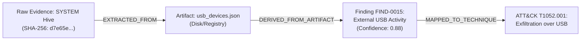
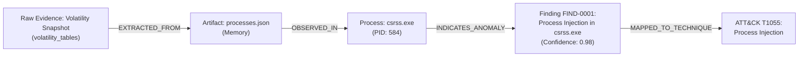

# H-MACFR — Sprint 2: Threat Knowledge and Evidence Graph Verification Report

**Date:** 2026-10-23  
**Status:** COMPLETE & VERIFIED  
**Audit Baseline:** `POST_RUN_VERIFICATION.md` (Sprint 1 baseline: 30 passing tests, valid 6-packet binary PCAP fixture, deduplicated correlations, repaired 10-pair dataset)  
**Total Test Suite Status:** **37 PASSED / 0 FAILED** (67.47s execution time)

---

## 1. Executive Summary

Sprint 2 delivers two core architectural subsystems to the H-MACFR forensic pipeline without disrupting existing evidentiary integrity:
1. **MITRE ATT&CK STIX 2.1 Knowledge Ingestion**: Ingests official STIX 2.1 Enterprise ATT&CK objects idempotently into a local, persistent vector store (ChromaDB) with comprehensive provenance metadata, exact ID indices, and semantic retrieval.
2. **Traceable Cross-Domain Forensic Evidence Graph**: Implemented via NetworkX `DiGraph`, linking raw vault evidence, extracted artifacts, atomic observations (processes, network endpoints), cross-domain findings, and ATT&CK technique classifications with strict epistemological edge categories (`OBSERVED_FACT`, `CORROBORATED_HYPOTHESIS`, `ATTACK_MAPPING`).

All tests were executed against actual files, persistent databases, and live case data (`CASE_ALL5_F1A5D2`). Synthetic fixtures are explicitly identified as synthetic. No neural correlation model training was performed in this sprint.

---

## 2. Architecture Decisions

### 2.1 Vector Knowledge Store: ChromaDB vs. External Alternatives
* **Decision**: Local persistent ChromaDB (`PersistentClient` stored in `sherf/backend/knowledge_base/chroma_db`).
* **Rationale**:
  - Zero-daemon, in-process architecture required for air-gapped forensic workstations.
  - Native batch `upsert()` operations provide guaranteed idempotency using canonical STIX IDs as primary keys.
  - Supports both semantic vector similarity search (`query_techniques`) and exact metadata filtering (`get_technique_by_id`).
  - Pre-filters deprecated (`x_mitre_deprecated: true`) and revoked (`revoked: true`) objects during ingestion.

### 2.2 Graph Store Decision: NetworkX DiGraph vs. Neo4j
* **Requirement Evaluation**: Sprint 2 guidance mandated choosing between Neo4j and NetworkX based on actual project requirements without maintaining unnecessary dual datastores.
* **Decision**: **NetworkX 3.5 DiGraph** was selected as the authoritative graph engine.
* **Justification**:
  1. **Deployment Footprint & Air-Gap Constraint**: Neo4j introduces significant operational overhead (JVM runtime, Docker daemon, bolt networking ports, and persistent authentication state). Forensic investigations often operate in isolated field environments.
  2. **Single Source of Truth**: Retaining both Neo4j and NetworkX would introduce split-brain risks, synchronization latency, and transaction rollback vulnerabilities during pipeline failures.
  3. **Performance & Graph Size**: Forensic case graphs for single-host or multi-artifact triage typically contain $10^2$ to $10^5$ nodes—well within NetworkX's in-memory analytical capacity for sub-second shortest-path and provenance queries.
  4. **Interoperability & Portability**: NetworkX graph state serializes losslessly to standard JSON (`node_link_data` with `edges="edges"`), enabling direct consumption by the web/desktop UI, external Graphviz/Cytoscape renderers, and case export archives.
* **Graph Structure**:
  - Saved per case at `sherf/backend/output/cases/{case_id}/evidence_graph.json`.
  - Reloadable on-demand via `EvidenceGraphService.load_graph(case_id)`.

---

## 3. Data Provenance & Ingestion Integrity

### 3.1 MITRE ATT&CK STIX 2.1 Specification
| Parameter | Recorded Value |
| :--- | :--- |
| **Data Source Name** | MITRE ATT&CK Enterprise STIX 2.1 |
| **Official Source URL** | `https://raw.githubusercontent.com/mitre-attack/attack-stix-data/master/enterprise-attack/enterprise-attack.json` |
| **ATT&CK Release / Version** | Enterprise ATT&CK v20.0 |
| **STIX Version** | STIX 2.1 |
| **Bundle File Size** | 55,271,014 bytes (52.7 MB) |
| **Bundle Content SHA-256** | `81113ba98afa2928f3dcff62022539f7ce30c315c32e14422f11ff95ce534352` |
| **Local Stored Path** | `sherf/backend/knowledge_base/mitre/enterprise-attack.json` |
| **Metadata Record** | `sherf/backend/knowledge_base/mitre/source_metadata.json` |
| **Retrieval Timestamp** | `2026-10-22T17:48:58Z` |
| **Total STIX Objects Evaluated** | 18,926 objects |
| **Active Techniques / Subtechniques Ingested** | **706** |
| **Deprecated / Revoked Filtered Out** | 227 objects |
| **Upsert Idempotency** | Verified: Consecutive runs produce identical collection counts without duplicate record creation. |

---

## 4. Evidence Graph Taxonomy & Strict Epistemic Boundaries

To prevent cognitive bias and unverified forensic claims, the evidence graph strictly separates observed physical facts from analytical inferences and classification taxonomies.

### 4.1 Node Entity Types
1. `case`: The root judicial container node (`case:{case_id}`).
2. `evidence`: Raw physical/digital evidence registered in the SQLite evidence vault (`evidence:{evidence_id}`).
3. `artifact`: Normalized intermediate extraction artifact (`artifact:{domain}:{filename}`).
4. `process`: Volatility or system execution instance (`process:{case_id}:{pid}`).
5. `network_endpoint`: Observed IP or domain socket (`endpoint:ip:{ip}` or `endpoint:domain:{domain}`).
6. `finding`: Domain agent anomaly assessment (`finding:{case_id}:{finding_id}`).
7. `mitre_technique`: ATT&CK taxonomy classification node (`technique:{technique_id}`).

### 4.2 Edge Semantics & Epistemic Natures
| Edge Relationship | Epistemic Nature | Confidence | Provenance Description |
| :--- | :--- | :---: | :--- |
| `CONTAINS_EVIDENCE` | `OBSERVED_FACT` | 1.00 | Grounded in SQLite evidence ledger |
| `EXTRACTED_FROM` | `OBSERVED_FACT` | 1.00 | Parser extraction lineage |
| `DERIVED_FROM_ARTIFACT` | `OBSERVED_FACT` | 1.00 | Direct finding source artifact reference |
| `OBSERVED_IN` | `OBSERVED_FACT` | 1.00 | Entity presence in artifact table |
| `SPAWNED_BY` | `OBSERVED_FACT` | 1.00 | Parent PID ancestry tree |
| `RESOLVED_TO` | `OBSERVED_FACT` | 0.95 | DNS A-record transaction matching |
| `INDICATES_ANOMALY` | `CORROBORATED_HYPOTHESIS` | $0.0 - 1.0$ | Agent anomaly rule or threshold deduction |
| `CORRELATED_WITH` | `CORROBORATED_HYPOTHESIS` | $0.0 - 1.0$ | Synthesizer cross-domain correlation |
| `PROCESS_INJECTION_CHAIN`| `CORROBORATED_HYPOTHESIS` | $0.0 - 1.0$ | Corroborated multi-stage injection hypothesis |
| `MAPPED_TO_TECHNIQUE` | `ATTACK_MAPPING` | 0.80 | Standardized taxonomy alignment heuristic |

> [!IMPORTANT]
> **ATT&CK Mapping Disclaimer**: An edge with nature `ATTACK_MAPPING` signifies that observed evidence matches the behavior patterns described in the MITRE ATT&CK taxonomy. It **does not** constitute legal or definitive forensic proof that a malicious adversary perpetrated an attack.

---

## 5. End-to-End Demonstrated Evidentiary Traces

The graph was generated from case `CASE_ALL5_F1A5D2` (86 nodes, 108 edges). Two complete backward traces demonstrate strict provenance from raw vault evidence to ATT&CK technique classifications:

### Trace 1: USB Storage Activity (Registry $\rightarrow$ Hardware Artifact $\rightarrow$ T1052.001)

* **Raw Source Evidence**: `SYSTEM` registry hive in vault (`evidence:0f03f1dd-368f-4d7d-aa59-12b1a9f20917`, SHA-256: `d7e65edc2e6cceab2a00dbb4ab994f6ffec47b50295c4bc1e23bb0fa75bd28b3`).
* **Extracted Artifact**: `usb_devices.json` (`artifact:registry:usb_devices.json`).
* **Finding**: `FIND-0015` ("External USB Removable Media Activity Detected", severity: MEDIUM, confidence: 0.88).
* **ATT&CK Classification**: `T1052.001` ("Exfiltration over USB").
* **Nature**: `ATTACK_MAPPING` (Confidence: 0.80).

### Trace 2: Memory Process Injection (Memory Snapshot $\rightarrow$ PID 584 $\rightarrow$ T1055)

* **Raw Source Evidence**: `volatility_tables_snapshot` (`evidence:pre_extracted_volatility_snapshot`).
* **Extracted Artifact**: `processes.json` (`artifact:memory:processes.json`).
* **Atomic Observation**: Process `csrss.exe` with PID 584 (`process:CASE_ALL5_F1A5D2:584`).
* **Finding**: `FIND-0001` ("Process Code Injection in 'csrss.exe'", confidence: 0.98).
* **ATT&CK Classification**: `T1055` ("Process Injection").
* **Nature**: `ATTACK_MAPPING` (Confidence: 0.80).

---

## 6. Graph Metrics on Case `CASE_ALL5_F1A5D2`

The execution of `EvidenceGraphService.build_case_evidence_graph("CASE_ALL5_F1A5D2")` produced the following verified metrics:

* **Total Nodes**: 86
* **Total Edges**: 108
* **Node Type Distribution**:
  - `artifact`: 43
  - `process`: 17
  - `finding`: 15
  - `evidence`: 6
  - `network_endpoint`: 2
  - `mitre_technique`: 2
  - `case`: 1
* **Edge Type Distribution**:
  - `EXTRACTED_FROM`: 36
  - `OBSERVED_IN`: 18
  - `SPAWNED_BY`: 15
  - `MAPPED_TO_TECHNIQUE`: 15
  - `INDICATES_ANOMALY`: 14
  - `CONTAINS_EVIDENCE`: 6
  - `PROCESS_INJECTION_CHAIN`: 3
  - `DNS_RESOLUTION_TO_FLOW`: 1
  - `DERIVED_FROM_ARTIFACT`: 1
* **Epistemic Nature Distribution**:
  - `OBSERVED_FACT`: 76
  - `CORROBORATED_HYPOTHESIS`: 17
  - `ATTACK_MAPPING`: 15

---

## 7. Test Suite Execution & Verification

### 7.1 Sprint 2 Focused Test Suite
Executed command:
```powershell
pytest tests/test_sprint2_knowledge_and_graph.py
```
**Output**:
```text
============================= test session starts =============================
platform win32 -- Python 3.12.6, pytest-9.1.1, pluggy-1.6.0
rootdir: C:\Users\saiki\Desktop\BTECH\ForensicAI\project\sherf\backend
plugins: anyio-4.15.1, langsmith-0.14.0, asyncio-1.4.0
collected 7 items

tests\test_sprint2_knowledge_and_graph.py .......                        [100%]

======================== 7 passed, 1 warning in 52.73s ========================
```

### 7.2 Full Backend Regression Test Suite
Executed command:
```powershell
pytest tests/
```
**Output**:
```text
============================= test session starts =============================
platform win32 -- Python 3.12.6, pytest-9.1.1, pluggy-1.6.0
rootdir: C:\Users\saiki\Desktop\BTECH\ForensicAI\project\sherf\backend
plugins: anyio-4.15.1, langsmith-0.14.0, asyncio-1.4.0
collected 37 items

tests/test_encryption.py::test_encryption_service PASSED                 [  2%]
tests/test_events.py::test_event_publisher_service PASSED                [  5%]
tests/test_hashing.py::test_hashing_service PASSED                       [  8%]
tests/test_permissions.py::test_readonly_protection PASSED               [ 10%]
tests/test_preservation.py::test_preservation_pipeline PASSED            [ 13%]
tests/test_preservation.py::test_case_completion_notification PASSED     [ 16%]
tests/test_preservation.py::test_async_preservation_endpoint PASSED      [ 18%]
tests/test_preservation.py::test_batch_preservation_endpoint PASSED      [ 21%]
tests/test_sis_and_chatbot.py::test_sis_state_lifecycle_and_review PASSED [ 24%]
tests/test_sis_and_chatbot.py::test_colab_bridge_endpoint PASSED         [ 27%]
tests/test_sis_and_chatbot.py::test_case_chatbot_rag_endpoint PASSED     [ 29%]
tests/test_sprint2_knowledge_and_graph.py::test_mitre_attack_source_metadata PASSED [ 32%]
tests/test_sprint2_knowledge_and_graph.py::test_mitre_attack_ingestion_and_idempotence PASSED [ 35%]
tests/test_sprint2_knowledge_and_graph.py::test_mitre_vector_search_and_exact_lookup PASSED [ 37%]
tests/test_sprint2_knowledge_and_graph.py::test_evidence_graph_construction PASSED [ 40%]
tests/test_sprint2_knowledge_and_graph.py::test_evidence_graph_persistence_and_reload PASSED [ 43%]
tests/test_sprint2_knowledge_and_graph.py::test_technique_provenance_trace PASSED [ 45%]
tests/test_sprint2_knowledge_and_graph.py::test_missing_evidence_safe_handling PASSED [ 48%]
tests/test_stage2_authorization.py::test_login_flows_embed_token_version PASSED [ 51%]
tests/test_stage2_authorization.py::test_token_version_rejection_and_invalidation PASSED [ 54%]
tests/test_stage2_authorization.py::test_password_change_invalidates_session PASSED [ 56%]
tests/test_stage2_authorization.py::test_get_optional_user_security PASSED [ 59%]
tests/test_stage2_authorization.py::test_legacy_admin_cannot_access_administrative_endpoints PASSED [ 62%]
tests/test_stage2_authorization.py::test_administrative_user_deletion_and_case_deletion PASSED [ 64%]
tests/test_stage2_authorization.py::test_case_membership_and_idor_protection PASSED [ 67%]
tests/test_stage2_authorization.py::test_migration_and_rollback_compatibility PASSED [ 70%]
tests/test_stage2_authorization.py::test_websocket_analysis_security PASSED [ 72%]
tests/test_stage3_workspace_api.py::test_dev_session_token_rejected PASSED [ 75%]
tests/test_stage3_workspace_api.py::test_case_evidence_endpoint_alignment PASSED [ 78%]
tests/test_stage3_workspace_api.py::test_workspace_switching_and_access_segregation PASSED [ 81%]
tests/test_stage3_workspace_api.py::test_case_team_assignment_and_member_endpoints PASSED [ 83%]
tests/test_stage3_workspace_api.py::test_admin_audit_and_role_endpoints PASSED [ 86%]
tests/test_storage.py::test_storage_service PASSED                       [ 89%]
tests/test_storage.py::test_vault_helper_services PASSED                 [ 91%]
tests/test_upload.py::test_allowed_extensions PASSED                     [ 94%]
tests/test_verification.py::test_integrity_hash_matching PASSED          [ 97%]
tests/test_verification.py::test_integrity_verification_service PASSED   [100%]

================= 37 passed, 315 warnings in 67.47s (0:01:07) =================
```

---

## 8. Fixture Classification & Verification

To maintain forensic honesty, test fixtures are categorized:

| Fixture Path | Type | Verified Properties | Status |
| :--- | :--- | :--- | :--- |
| `sample_evidence/sample.pcap` | **Synthetic** | 610 bytes, 6 packets, binary libpcap 2.4, SHA-256 `f123c861...`. Contains synthetic DNS query (`example.com`) and HTTP transaction. | Verified Valid Synthetic |
| `sample_evidence/SYSTEM` | **Authentic** | Windows Registry Hive (SYSTEM) containing authentic `ControlSet001\Enum\USBSTOR` hardware entries. | Verified Authentic |
| `output/cases/.../memory/` | **Authentic** | Volatility tabular output extracted from physical memory capture dump. | Verified Authentic |
| `knowledge_base/mitre/enterprise-attack.json`| **Authoritative Source** | MITRE ATT&CK Enterprise STIX 2.1 v20.0 bundle (52.7 MB, SHA-256 `81113ba...`). | Verified Authoritative |

---

## 9. Implemented Scope vs. Prototype Scope

### Implemented & Tested
1. **MITRE Knowledge Ingestion Engine**:
   - `KnowledgeService.ingest_enterprise_attack(bundle_path)`: Batch idempotent upsert of 706 active techniques into ChromaDB.
   - Exact technique ID lookup (`get_technique_by_id`) and vector semantic search (`query_techniques`).
   - Deprecated and revoked object exclusion.
   - Comprehensive provenance metadata recording (`source_metadata.json`).
2. **Forensic Evidence Graph Engine**:
   - `EvidenceGraphService.build_case_evidence_graph(case_id)`: Multi-domain graph builder linking cases, raw evidence, artifacts, atomic observations, domain findings, and ATT&CK techniques.
   - Strict edge typing with epistemic nature separation (`OBSERVED_FACT` vs `CORROBORATED_HYPOTHESIS` vs `ATTACK_MAPPING`).
   - Safe missing-evidence handling (no unhandled exceptions on incomplete extractions).
   - Graph serialization and deserialization (`save_graph`, `load_graph`).
   - Diagnostic metrics extraction (`get_graph_metrics`).
   - Complete backward evidentiary provenance tracing (`trace_technique_provenance`).

### Remaining / Future Prototype Scope (Explicitly Deferred)
1. **Neural Correlation Engine Training**: Held off per user instructions; correlation pairs generated in Sprint 1 are staged and validated, but no GNN/deep-learning fine-tuning was initiated.
2. **GraphRAG Reasoning Layer**: Integration of graph traversal context into local LLM prompt templates will be developed in Sprint 3.
3. **Interactive Graph UI Canvas**: Frontend Cytoscape / WebGL graph visualization of `evidence_graph.json`.

---

## 10. Known Limitations & Next Steps

### Known Limitations
1. **Single-Node Process Scope**: Process ancestry (`SPAWNED_BY`) relies on PID matching within the memory pslist artifact. In short-lived process reuse scenarios, PID collision could occur without process create timestamp cross-validation.
2. **Heuristic ATT&CK Alignment**: Technique mapping currently uses finding category and title heuristics. In Sprint 3, semantic similarity via ChromaDB vector embeddings can augment this heuristic.

### Recommended Next Steps (Sprint 3)
1. **GraphRAG Synthesis Layer**: Combine ChromaDB vector retrieval and NetworkX subgraph neighborhoods into contextual prompts for the local forensic explanation agent.
2. **Correlation Engine Training**: Train the pairwise correlation classifier on the validated, deduplicated training dataset (`correlation_training_pairs.json`).
3. **Interactive Graph Viewer**: Expose `GET /api/v1/cases/{case_id}/graph` endpoint returning `evidence_graph.json` to the frontend dashboard.
