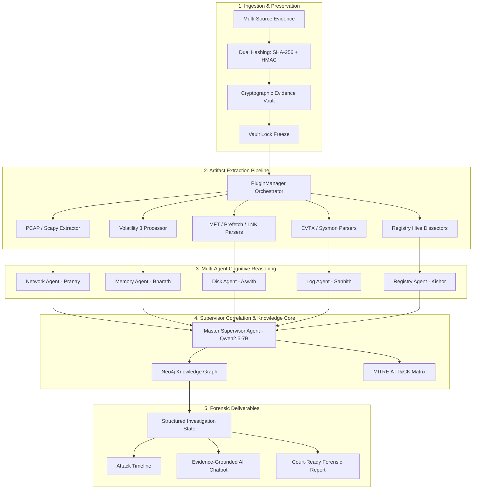
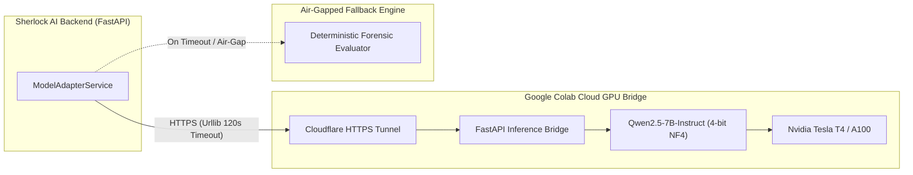

# 🛡️ Agentic Sherlock AI — System Architecture & Technical Specification

**Framework**: Hierarchical Multi-Agent Cognitive Forensic Reconstruction Framework (H-MACFR)  
**Project**: B.Tech Capstone Project — Team G1266  
**Mentor**: Para Upendar  
**Domain Agents & Specialists**:
- 🌐 **Pranay** — Network Forensics Agent (`network`)
- 🧠 **Bharath** — Memory Volatility Agent (`memory`)
- 💾 **Aswith** — Filesystem & Disk Agent (`disk`)
- 📜 **Sanhith** — Security Event Log Agent (`logs`)
- 🗄️ **Kishor** — Windows Registry Agent (`registry`)
- 👑 **Supervisor** — Cognitive Cross-Domain Correlation Orchestrator (Qwen2.5-7B LoRA)

---

## 1. Architectural Philosophy

Traditional digital forensic incident response (DFIR) relies on fragmented command-line utilities (Wireshark, Volatility, Chainsaw, RegRipper), forcing human examiners to manually cross-reference disconnected logs, memory artifacts, and network streams. 

**Agentic Sherlock AI (H-MACFR)** automates attack reconstruction through a **hierarchical cognitive multi-agent framework**:
1. **Cryptographic Integrity First**: Strict ISO/IEC 27037 preservation with immutable hashing and vault locking.
2. **Domain-Specific Cognitive Decomposition**: 5 specialized agents each master a distinct forensic domain with dedicated LoRA adapters.
3. **Epistemic Cross-Domain Correlation**: A high-level supervisor model links low-level indicators into validated causal chains.
4. **Structured Investigation State (SIS)**: Normalizes findings into a verifiable graph state with human-in-the-loop review.

---

## 2. System Zones & Security Architecture

### Zone 0: Access Control & Case Segregation (RBAC)
- **Role Hierarchy**:
  - `Platform Super Admin`: Unrestricted system governance.
  - `Access Administrator`: User credential & role lifecycle management.
  - `Lead Investigator`: Case owner; full case lifecycle control, vault management, and report sign-off.
  - `Investigator`: Evidence ingestion, extraction triggering, and hypothesis formulation.
  - `Forensic Analyst`: Specialist analysis and evidence inspection.
  - `Platform Auditor`: Read-only compliance inspection.
- **Session Security**: JWT bearer tokens signed via HS-256 with embedded `token_version` tracking for immediate session revocation upon privilege changes.

### Zone 1: Evidence Ingestion & Cryptographic Vault (ISO/IEC 27037)
- **Cryptographic Sealing**:
  - **SHA-256**: Primary NIST-compliant integrity digest computed via multi-pass streaming buffers.
  - **HMAC-SHA256**: Authenticated keyed digest verifying origin and preventing unauthorized replacement.
- **Vault Lifecycle Controls**:
  - `OPEN`: Initial stage allowing continuous ingestion (`+ Upload More` evidence files).
  - `LOCKED`: Freezes the case evidence pool; rejects uploads and deletions to maintain pristine chain of custody.
  - `UNLOCKED`: Requires formal justification recorded in the tamper-evident audit ledger (`logs/audit_ledger.jsonl`).

---

## 3. The 5 Specialized Domain Agents

Each agent is tailored to forensic data schemas, utilizing domain-specific prompting and fine-tuned LoRA weights:

### 1. 🌐 Network Agent (Lead: Pranay)
- **Target Artifacts**: `.pcap`, `.pcapng`, `.eml`, `.msg`, browser SQLite databases (`History`, `Cookies`).
- **Extraction Adapters**: Python Scapy & dpkt network stream parsers.
- **Cognitive Responsibilities**:
  - C2 beaconing identification (interval jitter, beacon periodicity).
  - DNS exfiltration detection (high entropy domain lookups, TXT record tunnelling).
  - Lateral movement analysis (SMB/RPC port scanning, suspicious SSH connections).
- **Core Output Contracts**: `network_summary.json`, `dns_analysis.json`, `network_connections.json`, `browser_history.json`.

### 2. 🧠 Memory Agent (Lead: Bharath)
- **Target Artifacts**: `.raw`, `.dmp`, `.mem`, `.vmem` physical RAM images.
- **Extraction Adapters**: Volatility 3 framework integration (`windows.pslist`, `windows.malfind`, `windows.dlllist`, `windows.handles`).
- **Cognitive Responsibilities**:
  - Process injection & hollowing detection (`PAGE_EXECUTE_READWRITE` VAD allocations).
  - Unbacked shellcode execution and abnormal parent-child process relationships.
  - In-memory credential harvesting identification (LSASS memory dumps).
- **Core Output Contracts**: `memory_processes.json`, `injected_code.json`, `dll_modules.json`.

### 3. 💾 Disk Agent (Lead: Aswith)
- **Target Artifacts**: `.e01`, `.dd`, `.raw`, `.img`, `$MFT`, `.pf` (Prefetch), `.lnk` (Shortcuts), JumpLists.
- **Extraction Adapters**: Raw NTFS parser, Windows Prefetch decompressor, LNK binary header parser.
- **Cognitive Responsibilities**:
  - Proof of execution via Prefetch run counts and timestamps.
  - File timestomping detection via `$MFT` `$STANDARD_INFORMATION` vs `$FILE_NAME` delta analysis.
  - Anti-forensic wiping and staging directory discovery in `$Recycle.Bin`.
- **Core Output Contracts**: `execution_prefetch.json`, `mft_timeline.json`, `lnk_shortcuts.json`, `recycle_bin.json`.

### 4. 📜 Log Agent (Lead: Sanhith)
- **Target Artifacts**: `.evtx` (Windows Security, System, Application, Sysmon, PowerShell Operational).
- **Extraction Adapters**: Native EVTX xml dissectors and Chainsaw threat hunting rules.
- **Cognitive Responsibilities**:
  - Process creation correlation (Sysmon Event ID 1 & Windows Security 4688).
  - Obfuscated PowerShell script block reconstruction (Event ID 4104).
  - Pass-the-Hash / Pass-the-Ticket lateral movement (Event ID 4624 Type 3/9 logons).
- **Core Output Contracts**: `security_logons.json`, `process_creations.json`, `powershell_activity.json`, `eventlogs_summary.json`.

### 5. 🗄️ Registry Agent (Lead: Kishor)
- **Target Artifacts**: Offline registry hives (`SYSTEM`, `SOFTWARE`, `SAM`, `NTUSER.DAT`, `UsrClass.dat`).
- **Extraction Adapters**: Python-registry hive parsers.
- **Cognitive Responsibilities**:
  - Persistence mechanism enumeration (`Run`, `RunOnce`, Services, Winlogon).
  - Removable USB device historical tracking (`USBSTOR`, device serial numbers, mount points).
  - User activity reconstruction via `RecentDocs`, `UserAssist`, and `TypedURLs`.
- **Core Output Contracts**: `installed_software.json`, `usb_devices.json`, `run_keys.json`, `recent_files.json`.

---

## 4. Hardware Inference Architecture

1. **Remote Cloud GPU Bridge**:
   - Hosted on Google Colab with free-tier Nvidia Tesla T4 GPU (16GB VRAM).
   - Qwen2.5-7B-Instruct quantized in 4-bit NF4 (`bitsandbytes`) for sub-3-second generation.
   - Connected via secure Cloudflare Tunnel (`trycloudflare.com`).
2. **Air-Gapped Offline Fallback**:
   - If internet or tunnel is disconnected, the system automatically falls back to the deterministic local cognitive evaluator, ensuring zero data loss and 100% platform availability.

---

## 5. Structured Investigation State (SIS) & Attack Reconstruction

The Supervisor merges domain findings into a unified **Structured Investigation State (SIS)**:
- **Epistemic Classifications**:
  - `CAUSAL_DEPENDENCY`: Action A directly triggered Action B (e.g. Malicious Word doc spawned PowerShell).
  - `CORRELATIONAL_ASSOCIATION`: Indicators share entity overlap (e.g. Same internal IP accessed C2 and staged zip).
  - `COINCIDENTAL_NOISE`: Background OS telemetry unrelated to the breach.
- **Deliverables**:
  - **Graph Representation**: Neo4j Nodes (`Evidence`, `Process`, `IP`, `File`, `User`, `Technique`) and Edges (`EXECUTED`, `CONNECTED_TO`, `PERSISTS_VIA`).
  - **MITRE ATT&CK Attribution**: Tactics and Techniques mapped automatically (e.g. `T1059.001` PowerShell, `T1071.001` Web Protocols).
  - **Court-Ready PDF/JSON Export**: Cryptographically signed forensic report ready for courtroom presentation.
